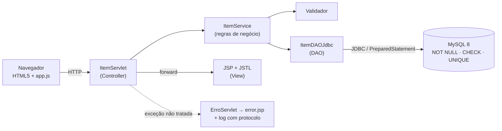
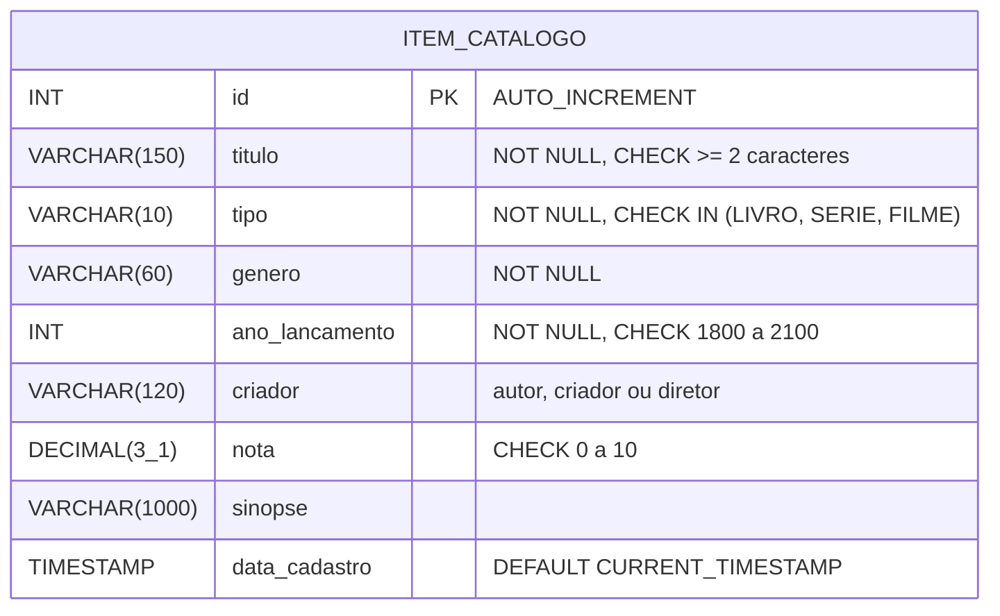

# Catálogo de Livros, Séries e Filmes

Aplicação web em **Java 17 · Servlets 6 · JSP/JSTL 3 · JDBC · MySQL 8** para catalogar livros, séries e filmes.
Foi desenvolvida como projeto de intervenção do **PICPIT – Situação-problema 2: Tratamento de Exceções e Validação de Dados**.

> **Problema:** a versão original aceitava dados inválidos (título vazio, ano futuro, nota fora de 0 a 10),
> mostrava *stack traces* ao usuário quando o banco falhava e deixava conexões abertas.
>
> **Solução:** validação em **três camadas** (navegador → servidor → banco), hierarquia de **exceções
> personalizadas**, **página de erro global** com registro em log e **try-with-resources** em todo acesso JDBC.

---

## Como executar

### Opção 1 – Demonstração rápida (sem instalar MySQL)

Usa um banco **H2 em memória** (modo de compatibilidade MySQL) já com dados de exemplo:

```bash
# Windows
mvnw.cmd -Pdemo jetty:run
# Linux / macOS
./mvnw -Pdemo jetty:run
```

Acesse **http://localhost:8080/catalogo**. Requer apenas JDK 17+ (o *Maven Wrapper* baixa o Maven automaticamente).

### Opção 2 – MySQL 8 + Tomcat 10.1

1. Crie o banco, o usuário e a tabela (como `root`):
   ```bash
   mysql -u root -p < database/mysql-setup.sql
   ```
2. Ajuste as credenciais em [`src/main/resources/db.properties`](src/main/resources/db.properties) **ou**,
   de preferência, por variáveis de ambiente / propriedades da JVM (não ficam no código):

   | Chave           | Variável de ambiente  | Propriedade da JVM       |
   |-----------------|-----------------------|--------------------------|
   | `db.url`        | `CATALOGO_DB_URL`     | `-Dcatalogo.db.url=...`  |
   | `db.usuario`    | `CATALOGO_DB_USUARIO` | `-Dcatalogo.db.usuario=` |
   | `db.senha`      | `CATALOGO_DB_SENHA`   | `-Dcatalogo.db.senha=`   |
   | `db.scripts`    | `CATALOGO_DB_SCRIPTS` | `-Dcatalogo.db.scripts=` |

3. Gere o pacote e publique no Tomcat 10.1 (Jakarta EE 10):
   ```bash
   mvnw.cmd clean package          # gera target/catalogo.war
   copy target\catalogo.war %CATALINA_HOME%\webapps\
   ```
4. Acesse **http://localhost:8080/catalogo**. Os logs da aplicação ficam em `%CATALINA_HOME%\logs\catalogo.AAAA-MM-DD.log`.

> Também é possível rodar com MySQL pelo Jetty: `mvnw.cmd jetty:run` (sem `-Pdemo`).

### Testes

```bash
mvnw.cmd test
```

São **103 casos de teste JUnit 5**, incluindo testes de integração do DAO com H2 (sem precisar de MySQL).

---

## Arquitetura



| Pacote                         | Responsabilidade                                                           |
|--------------------------------|----------------------------------------------------------------------------|
| `br.com.catalogo.model`        | Entidade `ItemCatalogo` e enum `TipoMidia` (LIVRO, SERIE, FILME)            |
| `br.com.catalogo.validation`   | `Validador`: todas as regras, acumulando os erros por campo                 |
| `br.com.catalogo.exception`    | Hierarquia de exceções da aplicação                                        |
| `br.com.catalogo.dao`          | `ItemDAO`, `ItemDAOJdbc`, `ConnectionProvider`, `ConnectionFactory`         |
| `br.com.catalogo.service`      | `ItemService`: valida, impede duplicados e coordena o DAO                   |
| `br.com.catalogo.web`          | `ItemServlet` (CRUD), `ErroServlet` (erro global), filtro de segurança, inicialização |
| `br.com.catalogo.config`       | `Configuracao`: lê propriedades da JVM, variáveis de ambiente e `db.properties` |
| `src/main/webapp`              | JSPs (`lista`, `formulario`, `error`), CSS e JavaScript                     |

### Rotas

| Método | URL                       | Ação                                   |
|--------|---------------------------|----------------------------------------|
| GET    | `/itens`                  | Lista (filtros `?busca=` e `?tipo=`)   |
| GET    | `/itens/novo`             | Formulário de cadastro                 |
| GET    | `/itens/editar?id=N`      | Formulário de edição                   |
| POST   | `/itens/salvar`           | Inclui ou altera (Post/Redirect/Get)   |
| POST   | `/itens/excluir`          | Exclui                                 |

---

## Modelo de dados



Chave única `uk_item_titulo_tipo_ano (titulo, tipo, ano_lancamento)` impede itens duplicados.
Script: [`src/main/resources/db/schema.sql`](src/main/resources/db/schema.sql).

---

## Validação em camadas

| Regra                                  | 1. Navegador (HTML5 + JS)          | 2. Servidor (`Validador`)                  | 3. Banco (constraint)      |
|----------------------------------------|------------------------------------|--------------------------------------------|----------------------------|
| Título obrigatório, 2 a 150 caracteres | `required minlength maxlength` + bloqueio de “só espaços” | vazio / só espaços / tamanho           | `NOT NULL`, `CHECK`, `VARCHAR(150)` |
| Tipo: Livro, Série ou Filme            | `<select required>`                | `TipoMidia.deTexto` (sem exceção)          | `CHECK (tipo IN ...)`      |
| Gênero obrigatório, até 60             | `required maxlength`               | vazio / tamanho                            | `NOT NULL`, `CHECK`        |
| Ano entre 1800 e o ano atual           | `type=number min max step=1`       | conversão segura + intervalo (ano futuro rejeitado) | `CHECK 1800..2100` |
| Nota de 0 a 10, uma casa decimal       | `type=number min=0 max=10 step=0.1`| conversão (aceita `7,5`) + intervalo + escala | `DECIMAL(3,1)`, `CHECK 0..10` |
| Criador até 120 / sinopse até 1000     | `maxlength` + contador             | tamanho                                    | `VARCHAR(n)`               |
| Item duplicado (título + tipo + ano)   | —                                  | `existeDuplicado` (ignora maiúsculas)      | `UNIQUE`                   |

Todos os erros do servidor são devolvidos **de uma só vez**, cada um **ao lado do seu campo**, e o formulário é
reexibido **com tudo o que o usuário digitou** (HTTP 422).

## Tratamento de exceções

```
RuntimeException
 └── CatalogoException
      ├── PersistenciaException          falhas de banco/JDBC → página de erro (500)
      │    └── RegistroDuplicadoException violação de UNIQUE → convertida em ValidacaoException
      ├── ItemNaoEncontradoException     id inexistente → 404
      └── RequisicaoInvalidaException    parâmetro malformado (?id=abc) → 400
Exception
 └── ValidacaoException (checada)        dados inválidos → formulário com erros (422)
```

* **DAO:** `try-with-resources` fecha `Connection`, `PreparedStatement` e `ResultSet` mesmo em caso de erro;
  toda `SQLException` é registrada no log (SQLState e código) e traduzida em `PersistenciaException` com mensagem amigável.
* **Serviço:** valida sempre antes de gravar; converte duplicidade (inclusive em concorrência) em `ValidacaoException`.
* **Servlet:** trata `ValidacaoException`, `ItemNaoEncontradoException` e `RequisicaoInvalidaException`; o resto segue
  para a página de erro global.
* **Página de erro global** (`web.xml` → `ErroServlet` → `error.jsp`): gera um **protocolo**, grava o *stack trace*
  completo no log junto com esse protocolo e mostra ao usuário apenas a mensagem amigável e o protocolo.
* **Segurança:** `PreparedStatement` (sem SQL Injection), `<c:out>` (sem XSS), Content-Security-Policy, cookies
  `HttpOnly` e credenciais fora do código-fonte.

---

## Casos de teste

| Classe de teste       | O que verifica                                                                                     |
|-----------------------|----------------------------------------------------------------------------------------------------|
| `ValidadorTest`       | Entradas válidas e limites; título vazio/curto/longo; tipo inválido; ano futuro, < 1800 e não numérico; nota fora de 0–10, com 2 casas e não numérica; acúmulo de erros |
| `ItemServiceTest`     | Dados inválidos nunca chegam ao DAO; duplicados (inclusive concorrência); edição; ids inexistentes; normalização |
| `ItemDAOJdbcTest`     | CRUD real em H2; filtros; SQL Injection; constraints UNIQUE/CHECK/NOT NULL; falha de conexão; **nenhuma conexão fica aberta** |
| `ExcecoesTest`        | Hierarquia checada/não checada, preservação da causa, mensagens amigáveis                           |
| `ModeloTest`, `FormularioItemTest`, `ScriptSqlRunnerTest`, `ConfiguracaoTest` | Utilitários e conversões                          |

### Roteiro de teste manual

| # | Ação                                                        | Resultado esperado                                         |
|---|-------------------------------------------------------------|------------------------------------------------------------|
| 1 | Cadastrar com título vazio                                  | Mensagem “O título é obrigatório.” ao lado do campo        |
| 2 | Cadastrar com ano 2099                                      | “O ano deve estar entre 1800 e <ano atual>.”               |
| 3 | Cadastrar com nota 11 ou -1                                 | “A nota deve estar entre 0 e 10.”                          |
| 4 | Cadastrar “Dark / Série / 2017” novamente                   | “Já existe um(a) série com o título "Dark" lançado(a) em 2017.” |
| 5 | Desativar o JavaScript e repetir 1–3                        | O servidor rejeita igualmente e mantém os dados digitados  |
| 6 | Acessar `/itens/editar?id=abc` e `/itens/editar?id=9999`    | Página amigável 400 e 404                                  |
| 7 | Parar o MySQL e abrir o catálogo                            | Página “Algo deu errado” com protocolo; stack trace só no log |

---

## Tecnologias

JDK 17 · Jakarta Servlet 6 · JSP/JSTL 3 · JDBC (MySQL Connector/J 8.4) · MySQL 8 · H2 (testes e demo) ·
JUnit 5 · Maven · Tomcat 10.1 / Jetty 12 · `java.util.logging`.

**Melhorias futuras:** Bean Validation (Jakarta Validation), pool de conexões (HikariCP), testes de integração
da camada web e token CSRF nos formulários.

